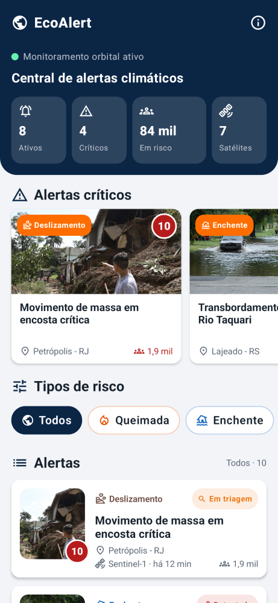
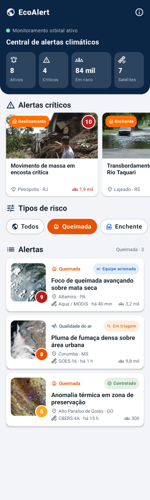
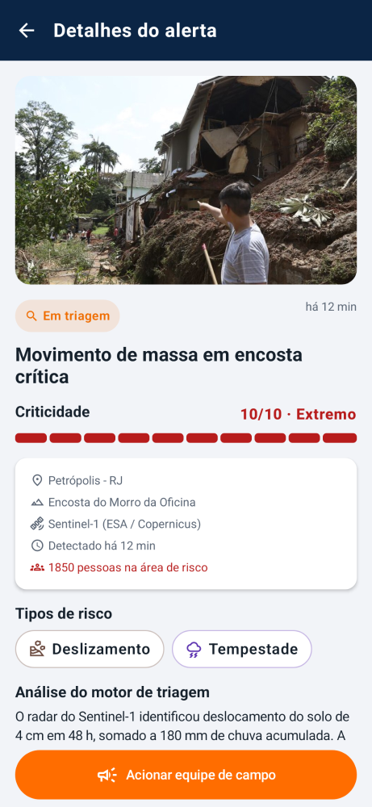
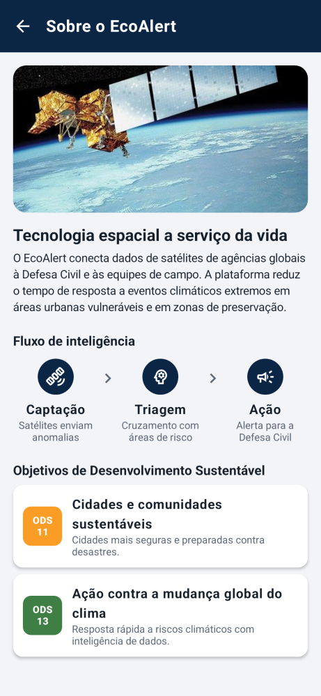

# EcoAlert (Android): alertas de riscos climáticos via satélite

> Global Solution 2026.2 · Android (Kotlin + Jetpack Compose + Material Design 3) · Tema **CitizenTech**

## Desenvolvedores

| Nome completo | RM |
|---|---|
| Davi Budin Pina | RM560135 |

## Tema da Global Solution

**CitizenTech** são tecnologias criadas a partir das necessidades reais das pessoas, para tornar a
vida mais segura, simples e sustentável. O desafio sugere criar *"sistemas de previsão de
enchentes, deslizamentos, incêndios e ondas de calor com alertas direcionados à população"*.

## Descrição da solução

O **EcoAlert** é uma plataforma de tecnologia espacial voltada à gestão de riscos climáticos
extremos. Ela leva dados orbitais de agências globais (NASA, ESA, NOAA e INPE) até a Defesa Civil e
os postos avançados de campo. Assim, o tempo de resposta cai e catástrofes podem ser evitadas em
áreas urbanas vulneráveis e em zonas de preservação ambiental.

O fluxo de inteligência da plataforma tem três etapas:

1. **Captação**: satélites enviam anomalias térmicas, atmosféricas ou hidrológicas.
2. **Triagem e severidade**: as anomalias são cruzadas com o cadastro de áreas vulneráveis
   (encostas críticas, matas secas e zonas de transbordamento) e recebem uma nota de
   **criticidade de 1 a 10**.
3. **Ação imediata**: alertas geográficos são enviados às equipes de resgate e às centrais.

Este aplicativo Android é a ponta dessa cadeia, usada pelo operador da Defesa Civil ou pela equipe
de campo.

## Principais funcionalidades

- **Painel da central**: alertas ativos, alertas críticos, pessoas em áreas de risco e
  quantidade de satélites que alimentam o sistema.
- **Alertas críticos** (`LazyRow`): alertas marcados como destaque, com imagem, tipo de risco,
  nota de criticidade, município e pessoas em risco.
- **Filtro por tipo de risco** (`LazyRow`): Todos, Queimada, Enchente, Deslizamento, Tempestade,
  Onda de calor, Seca e Qualidade do ar. O chip selecionado fica destacado e a lista é
  atualizada automaticamente.
- **Lista de alertas** (`LazyColumn`): ordenada da maior para a menor criticidade, com imagem,
  status, município, satélite de origem, tempo desde a detecção e pessoas em risco.
- **Detalhes do alerta**: medidor de criticidade, área vulnerável, satélite e agência, tipos de
  risco e análise do motor de triagem.
- **Acionar equipe de campo**: muda o status do alerta para "Equipe acionada", e todas as telas
  são atualizadas por recomposição.
- **Sobre**: fluxo de inteligência (Captação → Triagem → Ação) e ODS 11 e 13.

## Fluxo de telas

```
┌───────────────────────────────┐  toque em um alerta  ┌──────────────────────────────┐
│ Home (Central de alertas)     │ ───────────────────▶ │ Detalhes do alerta           │
│ • Painel de indicadores       │                      │ • Imagem                     │
│ • Alertas críticos (LazyRow)  │ ◀─────────────────── │ • Medidor de criticidade 1-10│
│ • Tipos de risco (LazyRow)    │  voltar (botão ou    │ • Local, área, satélite      │
│ • Alertas (LazyColumn)        │  gesto do sistema)   │ • Botão "Acionar equipe"     │
└───────────────────────────────┘                      └──────────────────────────────┘
          │ ícone (i)
          ▼
┌───────────────────────────────┐
│ Sobre o EcoAlert              │
│ • Fluxo de inteligência       │
│ • ODS 11 e 13                 │
└───────────────────────────────┘
```

## Prints das telas

| Home | Filtro "Queimada" | Detalhes do alerta | Sobre |
|---|---|---|---|
|  |  |  |  |

Os prints são gerados pelos testes de screenshot (`TelasScreenshotTest`, com Paparazzi), que
renderizam as telas reais do app.

## Fonte dos dados

**Repositório em memória.** O `AlertaRepository` mantém uma lista observável
(`mutableStateListOf`) de objetos `Alerta`, simulando a saída do motor de triagem do EcoAlert. O
app não consome API externa. O repositório isola a origem dos dados e pode ser trocado pela API de
notificações da plataforma sem alterar as telas.

As imagens estão em `res/drawable` e são exibidas com `Image` + `painterResource`. A origem delas
está nos créditos abaixo.

## Arquitetura e organização dos packages

```
br.com.fiap.ecoalert
├── MainActivity.kt                 # cria o repositório e chama EcoAlertApp
├── model/                          # modelos de dados
│   ├── Alerta.kt                   # data class Alerta (tipos: List<TipoRisco>, destaque: Boolean)
│   ├── TipoRisco.kt                # enum class TipoRisco (+ enum class TipoAnomalia)
│   ├── StatusAlerta.kt             # enum class StatusAlerta
│   └── FonteOrbital.kt             # enum class FonteOrbital (satélite + agência)
├── repository/
│   └── AlertaRepository.kt         # fonte única dos dados + consultas e filtros
├── ui/
│   ├── EcoAlertApp.kt              # navegação entre telas (remember + mutableStateOf)
│   ├── screens/                    # telas
│   │   ├── HomeScreen.kt
│   │   ├── DetalheAlertaScreen.kt
│   │   └── SobreScreen.kt
│   ├── components/                 # @Composable reutilizáveis
│   │   ├── AlertaCard.kt           # item da lista principal
│   │   ├── TipoRiscoChip.kt        # item de categoria (reusado no detalhe)
│   │   ├── TiposRiscoRow.kt        # LazyRow de categorias
│   │   ├── AlertaCriticoCard.kt    # item de destaque
│   │   ├── AlertasCriticosRow.kt   # LazyRow de destaques
│   │   ├── AlertaImagem.kt         # Image recortada (reusada em 3 lugares)
│   │   ├── CriticidadeBadge.kt     # selo 1-10 (reusado em 2 cards)
│   │   ├── CriticidadeMedidor.kt   # barra de criticidade
│   │   ├── StatusBadge.kt          # selo de status (reusado no card e no detalhe)
│   │   ├── InfoItem.kt             # ícone + texto (reusado em todos os cards)
│   │   ├── PainelResumo.kt         # cabeçalho + ResumoCard
│   │   ├── SecaoTitulo.kt          # título padrão das seções
│   │   └── FluxoInteligencia.kt    # captação → triagem → ação
│   └── theme/                      # cores, tipografia e espaçamentos (Material 3)
└── util/
    └── Formatadores.kt             # "há 12 min", "12 mil"
```

**Camadas**

- **Model**: `data class Alerta`, com construtor primário e atributos tipados. Um alerta pode ter
  vários tipos de risco (`List<TipoRisco>`), tem `criticidade` de 1 a 10 e `destaque: Boolean`.
- **Enums**: `TipoRisco`, `StatusAlerta` e `FonteOrbital` são `enum class` com rótulo, ícone e cor.
  Nenhuma regra de filtragem usa strings.
- **Repository**: `AlertaRepository` centraliza os registros e expõe `obterTodos()`,
  `obterPorTipo(TipoRisco?)`, `obterCriticos()`, `obterPorId()`, os indicadores e
  `acionarEquipe()`. Uma única instância, criada na `MainActivity`, é compartilhada pelas telas.
- **Estado**: `EcoAlertApp` guarda a tela atual e o tipo selecionado com
  `remember { mutableStateOf(...) }`. Ao trocar o tipo, a `HomeScreen` é recomposta e pede ao
  repositório a lista filtrada. Os componentes de apresentação nunca filtram dados.
- **Components**: funções `@Composable` sem estado, que recebem dados e callbacks e são
  reaproveitadas entre telas.

**Mapeamento dos requisitos**

| Requisito | Onde |
|---|---|
| Lista vertical: `LazyColumn` + `items`, ≥ 5 registros, Card, imagem, título + 2 informações | `HomeScreen.kt` + `AlertaCard.kt` (10 alertas) |
| Categorias: `LazyRow`, ≥ 5, "Todos", destaque visual, `remember`/`mutableStateOf`, `enum class` | `TiposRiscoRow.kt`, `TipoRiscoChip.kt`, `EcoAlertApp.kt` (7 tipos + Todos) |
| Destaques: `LazyRow`, ≥ 3, filtrados por `destaque`, `@Composable` próprio | `AlertasCriticosRow.kt`, `AlertaCriticoCard.kt`, `obterCriticos()` (4 críticos) |
| `data class` + `enum class` + `List<Categoria>` + booleano de destaque | `model/` |
| Repositório | `repository/AlertaRepository.kt` |
| Scaffold, TopAppBar, Column, Row, Card, LazyColumn, LazyRow, Modifier.padding, Spacer, Text, Icon, Image | telas e componentes |
| ≥ 3 `@Composable` reutilizáveis | 14 componentes em `ui/components/` |
| Interface sem XML | 100% Jetpack Compose (o XML é só manifest e recursos) |

## Como executar

1. Abra a pasta do projeto no **Android Studio** (Ladybug ou superior).
2. Aguarde o *Gradle Sync* e execute o app em um emulador ou dispositivo (Android 8.0+, API 26).

Pela linha de comando:

```bash
./gradlew assembleDebug           # gera app/build/outputs/apk/debug/app-debug.apk
./gradlew testDebugUnitTest       # testes do repositório
./gradlew recordPaparazziDebug    # regenera os prints das telas
```

Versões: Kotlin 2.1.0, AGP 8.7.3, Gradle 8.11.1, Compose BOM 2024.12.01, compileSdk 35, JDK 17.

## Vídeo pitch

Link do YouTube: https://youtu.be/LyXDn6NMR7k

## Créditos das imagens

Imagens do [Wikimedia Commons](https://commons.wikimedia.org), usadas para fins educacionais:

| Arquivo | Origem |
|---|---|
| `img_queimada.jpg` | File:Fires Arrive in the Amazon Rainforest (1489375).jpg (NASA) |
| `img_fumaca.jpg` | File:August 2020 NASA-Terra-Smoke-Covered-California.jpg (NASA) |
| `img_alagamento.jpg` | File:FEMA - 32096 - Cars drives though flooded street in an Oklahoma neighborhood.jpg (domínio público) |
| `img_deslizamento.jpg` | File:Chuvas em Petrópolis - Fevereiro 2022 01.jpg |
| `img_deslizamento_satelite.jpg` | File:Deadly landslides in Petropolis, Brazil (Copernicus).jpg (ESA/Copernicus) |
| `img_tempestade.jpg` | File:Supercell-thunderstorm-in-Kansas.jpg |
| `img_seca.jpg` | File:Cracked earth - Flickr - Al Jazeera English.jpg |
| `img_calor.jpg` | File:NASA SLC Urban Heat Island Effect Roof.jpg (NASA) |
| `img_termica.png` | File:Thermal Imagery of the Ferguson Fire in Northern California (NESDIS 2018-07-18).png (NOAA) |
| `img_arvore.jpg` | File:Fallen tree, 16th Street NW.jpg |
| `img_satelite.jpg` | File:Landsat 7 Artist’s Concept in Orbit.jpg (NASA) |
